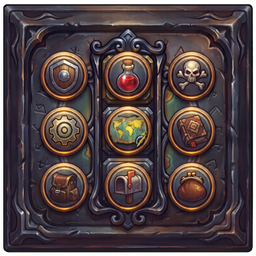

# MinimapButtonTray

One button next to the minimap that holds the minimap buttons of all your other addons. Click it and
they open in a tidy grid; click again (or wait) and they are gone.

**Classic Era and WoW Forever**, from one codebase, with a client abstraction so other flavours are a
TOC line away.

## Why another one

The collectors we could find were each tied to a single client, had bugs of their own (buttons fading
out inside the tray, buttons escaping back to the minimap, crashes alongside map-pin addons) and were
not open-licensed, so they could not be fixed. This one is MIT.

## Features

- Collects LibDBIcon buttons and every named addon button sitting on the minimap. Blizzard's own
  buttons, map pins and protected frames are left alone.
- Collected buttons **never fade out** while in the tray, whatever their addon thinks.
- Tray **auto-hides** after a configurable idle time (default 15 s, 0 = never) and optionally when the
  mouse leaves it.
- Grid grows in any of eight directions, N buttons per row, separate scale for the tray and the buttons.
- Untick a button in the options to leave it on the minimap; it goes back exactly where it was.
- Main button is draggable and follows the minimap if that moves. Optional: hide Blizzard's addon
  compartment on clients that have one.
- No libraries, no dependencies.

| click | action |
|---|---|
| Left | open / close the tray |
| Right | options |
| Drag | move the button |

## Slash `/mbt`

`/mbt` options · `toggle` · `show` · `hide` · `list` · `ignore <name>` · `unignore <name>` · `add <path>` ·
`remove <path>` · `reset` · `rescan` · `status` · `debug` · `help`

`/mbt debug` prints the client it detected, every frame it looked at on the minimap and why each was
collected or skipped. Paste that when a button is missing.

## Clients

| flavour | interface | status |
|---|---|---|
| Classic Era / Anniversary / Hardcore | 11509 | in development |
| WoW Forever | 16001 | in development |

## License

MIT
